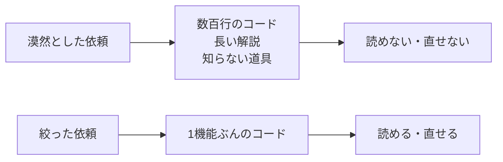
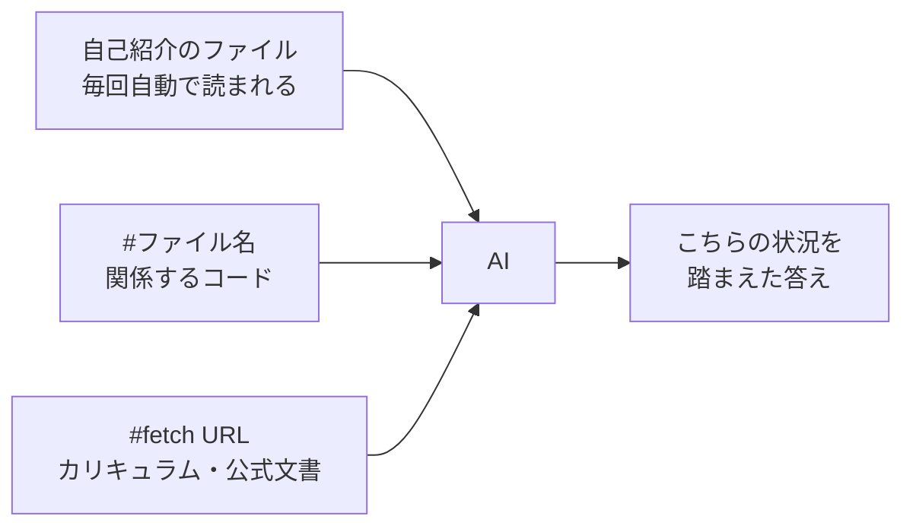
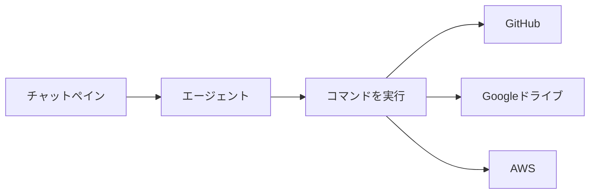
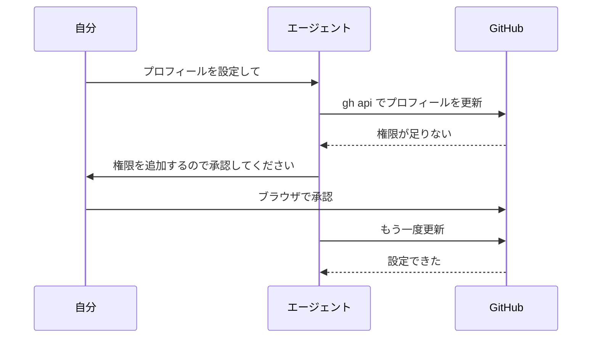

# AIを活用した開発（バイブコーディング）

近年は、AI（生成AI）に作りたいものを自然言語で伝え、コードを書いてもらう開発スタイルが広まっています。これはバイブコーディング（vibe coding）と呼ばれ、2025年に広まった言葉です。

## 主なツール

- GitHub Copilot — VSCodeに組み込んで使えるAIコーディング補助。書いている途中のコードを提案してくれます。GitHubアカウントでサインインすれば無料で使えます（補完は月2000回まで）。[学生認証](付録_学生認証.md)を通すと Copilot Student になり、補完の上限がなくなります。どちらもモデルは自動で選ばれ、自分では選べません。
- Cursor — AIを前提に作られたエディタ（VSCodeベース）。プロジェクト全体を理解して、コードの生成や修正ができます。
- Claude / ChatGPT など — チャットで相談しながらコードを書いてもらいます。

## 頼み方でスコープを絞る

うまくいかない最大の原因は、頼み方が漠然としていることです。予算で店を探すサイトを作って、とだけ頼むと、AIは数百行のコードと長い解説を一度に返してきます。しかも、自分が見たこともない道具で書かれていることがあります。動いても読めず、直せません。



絞るときは、作りたい機能を具体的に書き、一番小さい形から頼みます。

漠然とした頼み方

```
予算で店を探せるサイトを作ってください。
```

絞った頼み方

```
予算で店を探せるサイトを作りたいです。

作りたい機能
- 予算を入力すると、その予算以下の店が一覧で表示される
- 店の名前と予算が分かればよい

まず一番小さい形で作ってください。
```

1. 機能要件を伝える — 何ができればよいかを箇条書きにします。ここに挙げなかったものは作られません
2. 一番小さい形から頼む — 最初から全部を作らせないようにします

自分が使える道具も伝えます。言わないと、AIは知らないフレームワークを持ち出してきて、動いても読めず、発表で説明できません。ただ、毎回書くと長くなるので、このあとの「自己紹介を用意しておく」でファイルに書いておきます。

会話は続けられるので、動いたら次に店の詳細画面を足してください、と1機能ずつ広げていきます。

返ってくる説明が長すぎるときは、説明は不要です、コードだけ出してください、と伝えると量が減ります。

## 進め方


1. 何を作るかを、先に日本語で3行書きます。ここは自分で考える部分です
2. その3行を渡して、1つの機能だけ書かせます
3. 出てきたコードを読みます。説明できない行があれば、その行だけを指定して聞きます
4. 動かします。エラーが出たら、自分でエラーを読んでから、どの行で、何をしたら、何が出たかを伝えて直してもらいます
5. 動いたらコミットします。次の機能に進みます

## コンテキストを渡す

前の節で、使える道具や機能要件を文章で伝えました。これを毎回書くのは手間ですし、書き忘れも出ます。

AIに渡す情報をそろえる作業は、コンテキストエンジニアリングと呼ばれます。気の利いた言い回しを考えることではなく、判断に必要な材料を渡すことが中心です。



### ファイルを渡す

VS Code の Copilot では、チャット欄で `#` を打つとファイルを指定できます。

| 書き方 | 意味 |
| --- | --- |
| `#search.php` | そのファイルの中身を渡す |
| `#search.php #db.php` | 関係するファイルだけを渡す |
| `#fetch https://...` | そのページを読ませる |

ファイルをチャット欄にドラッグしても同じことができます。

コードの話をするときは、説明するより渡す方が速く、正確です。

```
#search.php 予算の上限で絞り込む条件を追加してください。
```

`#fetch` は、ページを読ませてから答えさせるときに使います。

資料を渡すと、それをもとにした答えが返ってきます。たとえば学科のカリキュラムを渡すと、自分のスキルセットを書き出させることができます。カリキュラムは次のPDFに載っています。

[令和8年度 学科ガイド（夜間部）](https://www.jec.ac.jp/wp-content/uploads/2026/04/07092232/course-guide-night2026-2.pdf)

ダウンロードしたPDFをチャット欄にドラッグして、次のように頼みます。

```
これは私の学科のカリキュラムです。
11〜14ページのネットワークセキュリティ科の必修科目をもとに、私が使えるはずの技術をスキルセットとして箇条書きにしてください。
資料に書かれていない具体的な言語やソフトウェアの名前は推測せず、最後に質問として並べてください。
```

### 自己紹介を用意しておく

使える道具や作っているものは、毎回同じです。ファイルに書いておけば、Copilot が自動で読みます。プロジェクトの直下に `.github/copilot-instructions.md` を作ってください。

```markdown
# このプロジェクトについて

## 私が使えるもの
- Python は授業で習いました
- HTML と CSS は少し書けます
- VS Code と Git は使えます
- Gradio は触ったことがあります

## 触ったことがないもの
- データベース
- Docker
- JavaScript のフレームワーク

## 作っているもの
- 予算を入力すると、その予算以下の店が一覧で表示されるWebサイト
- Google Colab 上で動かし、cloudflared で公開します

## お願いするときの約束
- 一度に1つの機能だけ書いてください
- 私が触ったことがないものを使うときは、先に理由を教えてください
- 説明は短くして、コードを優先してください
```

自分の状況に合わせて書き換えてください。触ったことがないものを正直に書くのが大事です。書いておけば、AIはそれを避けた作り方を選びます。

「私が使えるもの」は手で書かなくてかまいません。前の節で作らせたスキルセットを貼り付けます。授業の外で覚えたこと（Gradio など）は、そのあと自分で書き足します。

この内容は制作が進むにつれて変わります。データベースを使えるようになったら、その行を移します。

## コマンドとコードで操作する

繰り返す作業は、画面をクリックするのではなく、チャットペインから動かします。1回だけの作業は画面を操作した方が速いので、繰り返すものだけコードにします。

エージェントに頼めば、ターミナルのコマンドを実行します。先頭に `!` を付けると、コマンドを直接実行できます。どの道具を使うかはエージェントが選びます。



| 操作したいもの | コマンド | 準備の手順 |
| --- | --- | --- |
| GitHub | `gh` | [付録：GitHub CLI](付録_gh.md) |
| Googleドライブ | `rclone` | [付録：Googleドライブを操作する](付録_rclone.md) |
| AWS | `aws` | [付録：AWS CLI](付録_AWS_CLI.md) |

ただし、インストールとログインは、最初に自分で済ませておきます。ログインの仕組みは [付録：ブラウザでのログインとトークン](付録_ブラウザでのログインとトークン.md) にあります。

### 例：GitHubのプロフィールを設定する

GitHubのプロフィールに名前と所属を入れたいとします。設定画面がどこにあるか知らなくても、チャットペインで頼めば済みます。

```
GitHubのプロフィールに、名前「山田 太郎」と所属「日本電子専門学校」を設定してください。
```

エージェントは `gh` コマンドでGitHubのAPIを呼び出します。実際には、次のように進みます。



1回目は失敗しています。プロフィールの書き換えには `user` という権限が要るのに、まだ持っていなかったからです。エージェントはエラーを読んで、権限を追加するコマンドを実行し、承認を求めてきます。

ここで大事なのは、承認だけは自分でやるということです。ブラウザに表示されたコードを入力して、何の権限を渡すのかを確かめてから許可します。エージェントに任せるのは作業で、権限を渡す判断は自分が持ちます。

## 使うときの注意

AIが書いたコードは、まだ検証していない下書きです。

- 説明できないコードは残さない。理解して残すか、消すかのどちらかにします
- 過剰な防御は削る。頼まなくても入力検証や例外処理を厚く付けてくるので、読めない量に膨らみます
- 動かして確かめる。見た目が動いていても、不具合や穴があることがあります

研究発表では、どこを自分で直したかを説明してもらいます。

## AIの答えを公式ドキュメントで確かめる

AIは、古い情報や間違いを、正しいことのように答えます。特に、料金・無料で使える範囲・設定の書き方は、よく変わるので注意します。

確かめるときは、AIに公式ドキュメントのURLを出させて、自分で開きます。

```
その説明の根拠になる公式ドキュメントのURLを教えてください。
```

公式の説明とAIの答えが違ったら、公式を信じます。そのURLを `#fetch` で渡して、もう一度聞き直します。

### メタ認知：わかっていないところに気づく

自分が何をわかっていて、何をわかっていないかを、自分で把握することをメタ認知といいます。AIに任せていると、動いているだけで理解した気になり、メタ認知が働かなくなります。

AIが書いた設定やコードを、ときどき1行ずつ読み、○ 説明できる、△ なんとなく、× わからない、を付けます。たとえば、SSHの接続をAIに頼んで書かれた `~/.ssh/config` なら、次のようになります。

```
Host myserver                    ○ 接続先に付けた名前
  HostName 203.0.113.10          ○ 接続先のIPアドレス
  User ubuntu                    △ なんとなく
  IdentityFile ~/.ssh/mykey.pem  × わからない
```

× と △ の行は、公式ドキュメントで調べます。[OpenSSHの公式ドキュメント](https://man.openbsd.org/ssh_config) で `IdentityFile` を引くと、接続に使う秘密鍵のファイルを指定する項目だとわかります。

○ に変わったものは、[自己紹介](#_6) の「私が使えるもの」に移し、週次報告書の「今週学んだこと」に書きます。

説明できない設定は、説明できないコードと同じです。研究発表で「この行は何をしているか」と聞かれて答えられるようにしておきます。
