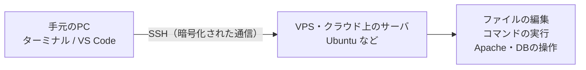
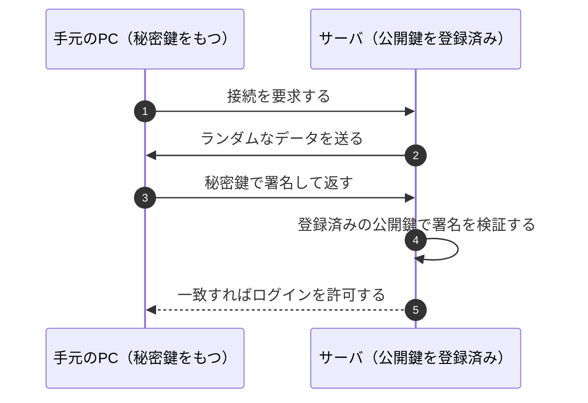
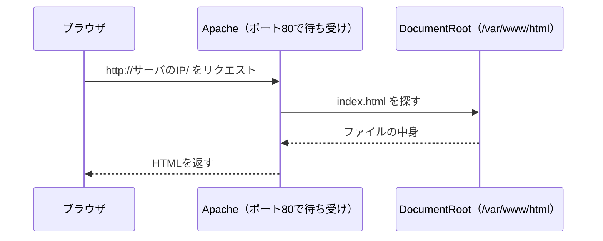
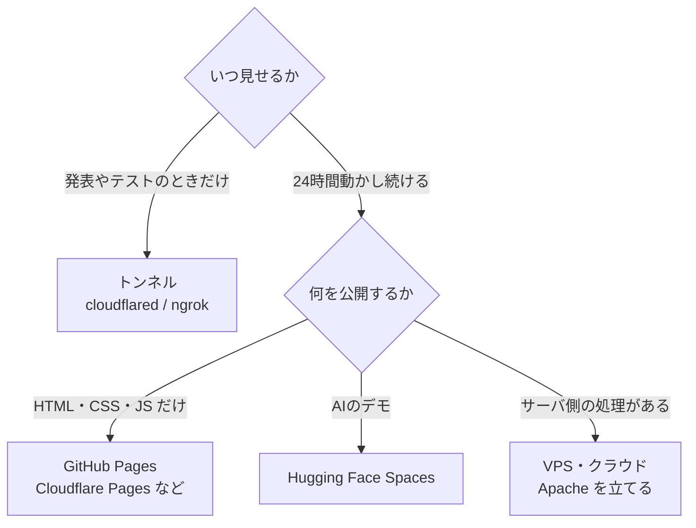
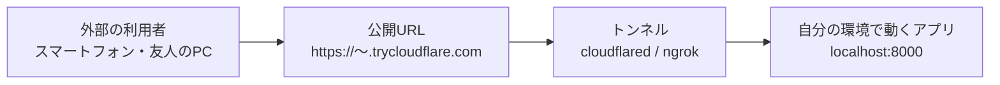

# サーバの構築と公開

借りたサーバに接続し、Webサーバを立てて、作ったものをインターネットに公開するまでを扱います。

## サーバへの接続（SSH）

SSHは、ネットワークを介して別のコンピュータに安全に接続し、遠隔操作するためのプロトコルです。通信経路が暗号化されるため、パスワードやコマンドを盗聴されません。仮想マシンやAWS、GCP、Azureなどのクラウドサービスを利用する場合、SSHを利用して開発するのが一般的です。

### 公開鍵認証のしくみ

SSHの接続では、パスワードの代わりに鍵のペアを使う「公開鍵認証」が広く使われています。公開鍵は接続先のサーバに登録し、秘密鍵は自分の端末だけに置きます。秘密鍵そのものはネットワークに流れないため、盗聴されても悪用されません。

秘密鍵は他人に渡してはいけません。GitHubなどに誤ってアップロードしないよう注意してください。

### VS Code から接続する（Remote - SSH）

VS Code の拡張機能 Remote - SSH を使うと便利です。ターミナルで `ssh` コマンドを打つ代わりに、使い慣れたエディタの画面のまま、サーバ上のファイルを編集したりコマンドを実行したりできます。

PowerShell からの接続、AWSの場合、Remote - SSH のインストールと使い方は、[付録：SSHの接続](付録_SSHの接続.md) にあります。

## Webサーバ（Apache）

Apacheは、広く使われているウェブサーバーソフトウェアです。Apacheを使うことで、作成したウェブサイト（HTMLやCSS、JavaScriptなどのファイル）をウェブサーバー上で公開することができます。

インストールや設定ファイルの書き方は、[付録：Apacheの設定](付録_Apacheの設定.md) にあります。

## インターネットへの公開

制作したものを他の人に見せたり試してもらったりするには、インターネットに公開する必要があります。中間発表でデモを見せる、友人にテストしてもらう、といった目的に応じて、手軽な方法から本格的な方法までいくつかの選択肢があります。

計画書の「公開方法」の欄には、この中のどれを使うのかを書きます。

### 一時的に公開する（トンネル）

自分のPC（localhost）で動かしているアプリを、そのまま外部からアクセスできるようにする方法です。手元で動かしたままURLを配れるので、デモやテストに向いています。

外部からの通信は、いったんトンネルの提供元を経由して、自分の環境で動いているアプリに届きます。サーバを借りなくても公開できるのはこのためです。

- ngrok: localhostに公開URLを割り当てる定番ツールです。無料でも固定のURLを1つ使えますが、1回の接続が2時間まで、通信量が月1GBまで、といった制限があります。
- Cloudflare Tunnel（TryCloudflare）: アカウント登録なしに、無料でHTTPSの公開URLを作れます。ngrokの有力な代替です。ポート番号を指定するだけなので、Gradioでも自作のHTTPサーバでも同じように公開できます。

### AIデモを公開する（Python）

Pythonで作ったAIや機械学習のプログラムを、Webページ付きで手軽に公開できるツールがあります。

- Gradio: 数行のコードで入力・出力のあるWeb画面を作れるライブラリです。公開URLの発行までライブラリだけで完結します。処理は自分のPCやColab上で動きます。
- Streamlit / Hugging Face Spaces: Streamlitも同様にPythonでWebアプリを作れるライブラリで、Hugging Face Spacesを使えばGradioやStreamlitのアプリを無料で常時公開できます。

### 本格的に公開する（ホスティング）

常時稼働させて誰でもアクセスできるようにするには、ホスティングサービスを利用します。無料枠のあるサービスも多くあります。

- 静的サイト（HTML/CSS/JS）: GitHub Pages、Cloudflare Pages、Netlify など
- アプリケーション: Render、Railway、Fly.io など
- AIアプリ: Hugging Face Spaces

前述のVPSやクラウド（AWSなど）にApacheを立てて公開する方法も、この「本格的に公開する」に含まれます。

### 公開するときのセキュリティ上の注意

トンネルやGradioの共有URLは、インターネットに直接アプリをさらすことになります。つまり、リンクを知っている人は誰でもアクセスでき、場合によってはプログラムを操作できてしまいます。

- 公開する内容にパスワードや個人情報を含めない
- 必要に応じてログイン認証をかける
- 使い終わったら、公開（トンネル）を必ず停止する

これらを徹底し、意図しない情報漏洩や不正アクセスを防ぎましょう。
