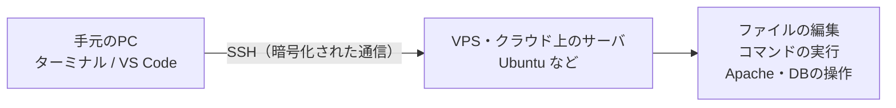
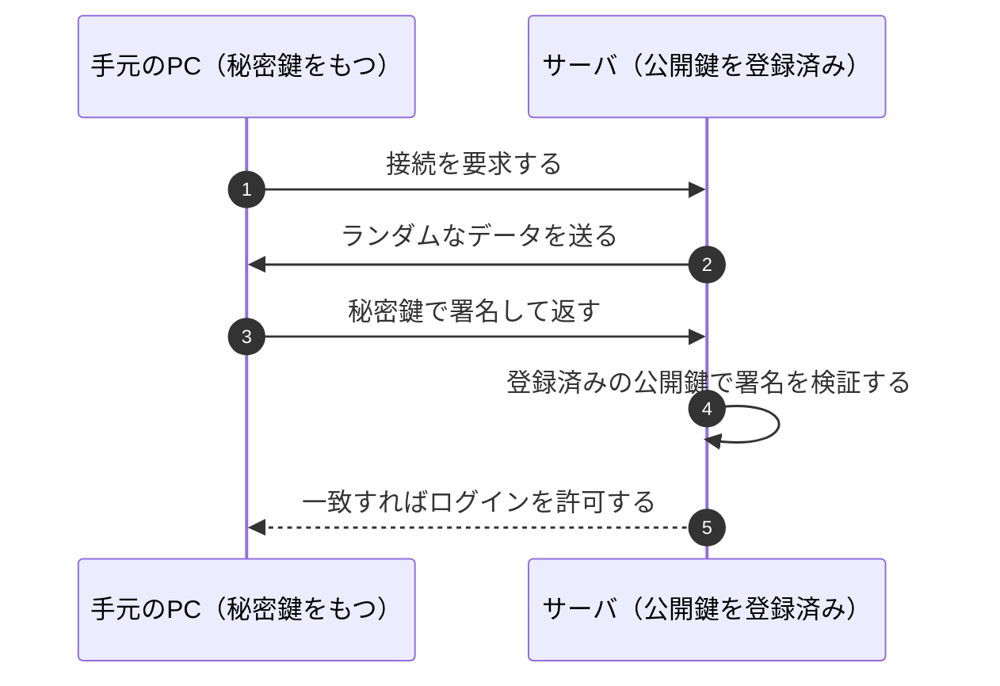
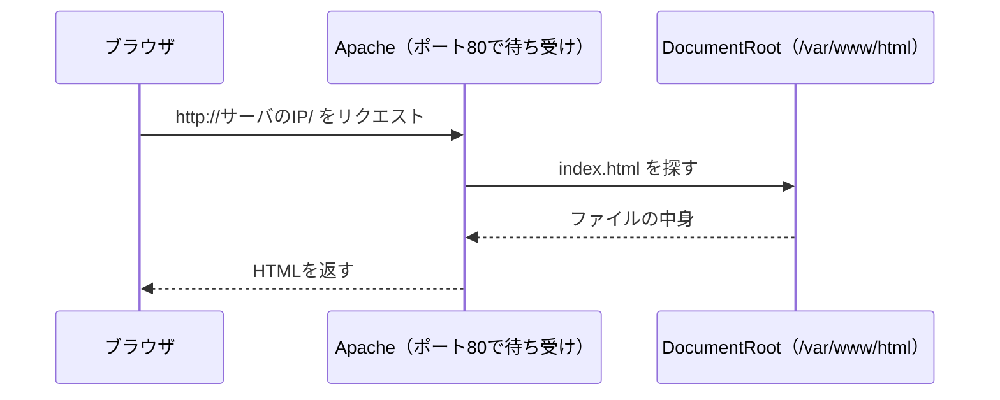
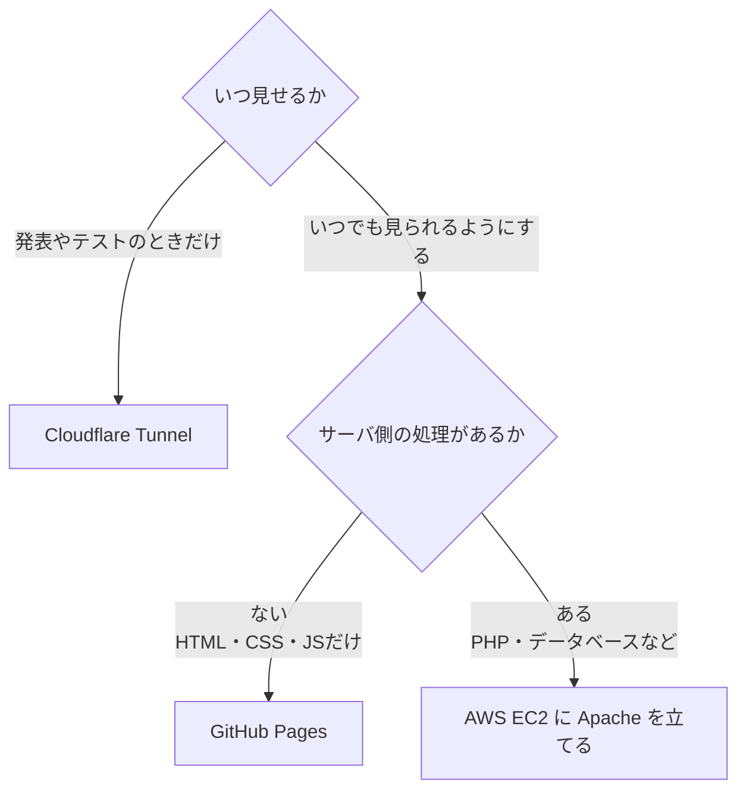

# サーバの構築と公開

借りたサーバに接続し、Webサーバを立てて、作ったものをインターネットに公開するまでを扱います。

## サーバへの接続（SSH）

SSHは、ネットワークを介して別のコンピュータに安全に接続し、遠隔操作するためのプロトコルです。通信経路が暗号化されるため、パスワードやコマンドを盗聴されません。仮想マシンやAWS、GCP、Azureなどのクラウドサービスを利用する場合、SSHを利用して開発するのが一般的です。



### 公開鍵認証のしくみ

SSHの接続では、パスワードの代わりに鍵のペアを使う「公開鍵認証」が広く使われています。公開鍵は接続先のサーバに登録し、秘密鍵は自分の端末だけに置きます。秘密鍵そのものはネットワークに流れないため、盗聴されても悪用されません。



秘密鍵は他人に渡してはいけません。GitHubなどに誤ってアップロードしないよう注意してください。

### VS Code から接続する（Remote - SSH）

VS Code の拡張機能 Remote - SSH を使うと便利です。ターミナルで `ssh` コマンドを打つ代わりに、使い慣れたエディタの画面のまま、サーバ上のファイルを編集したりコマンドを実行したりできます。

PowerShell からの接続、AWSの場合、Remote - SSH のインストールと使い方は、[付録：SSHの接続](付録_SSHの接続.md) にあります。

## Webサーバ（Apache）

Apacheは、広く使われているウェブサーバーソフトウェアです。Apacheを使うことで、作成したウェブサイト（HTMLやCSS、JavaScriptなどのファイル）をウェブサーバー上で公開することができます。



インストールや設定ファイルの書き方は、[付録：Apacheの設定](付録_Apacheの設定.md) にあります。

## インターネットへの公開

制作したものを他の人に見せるには、インターネットに公開します。いつ見せるか、何を公開するかで、使うものが決まります。



計画書の「公開方法」の欄には、この中のどれを使うのかを書きます。

### 一時的に公開する

自分のPCで動かしているアプリに、Cloudflare Tunnel で公開URLを付けます。サーバを借りずに、発表やテストのときだけ見せられます。手順は [付録：Cloudflare Tunnel で一時的に公開する](付録_Cloudflare_Tunnel.md) にあります。

Gradio で作った画面なら、Gradio の共有リンクも使えます。`launch()` に `share=True` を付けるだけで、`https://～.gradio.live` のURLが発行されます。リンクは1週間で使えなくなります。

```python
demo.launch(share=True)
```

### いつでも見られるようにする

HTML・CSS・JavaScript だけでできたページなら、GitHub Pages で無料で公開できます。手順は [付録：GitHub Pages で公開する](付録_GitHub_Pages.md) にあります。

サーバ側で処理が動くものは、AWS EC2 にサーバを用意し、Apache を立てて公開します。接続は [付録：SSHの接続](付録_SSHの接続.md)、設定は [付録：Apacheの設定](付録_Apacheの設定.md) にあります。

### 公開するときのセキュリティ上の注意

公開したものは、インターネットに直接さらされます。つまり、リンクを知っている人は誰でもアクセスでき、場合によってはプログラムを操作できてしまいます。

- 公開する内容にパスワードや個人情報を含めない
- 必要に応じてログイン認証をかける
- Cloudflare Tunnel は、使い終わったら必ず止める

これらを徹底し、意図しない情報漏洩や不正アクセスを防ぎましょう。
