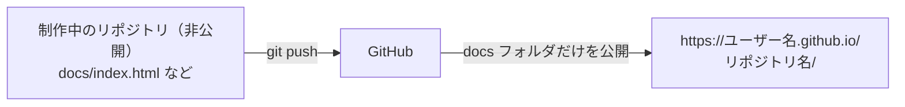

# 付録：GitHub Pages で公開する

HTML・CSS・JavaScript でできたページを、GitHubから無料で公開します。この教材のサイトも GitHub Pages で公開しています。

PHP やデータベースのように、サーバ側で処理が動くものは公開できません。その場合は AWS EC2 に Apache を立てます。



## 前提：学生認証

学生認証が通ると GitHub Pro が無料になり、非公開のリポジトリからでも GitHub Pages を使えます。制作中のリポジトリを非公開のまま、ページだけを公開できます。認証の手順は [付録：GitHub の学生認証](付録_学生認証.md) にあります。

リポジトリは非公開でも、公開したページは誰でも見られます。公開するフォルダに、パスワードやAPIキーを置かないでください。

## 公開するファイルを docs フォルダに置く

公開したいページは、リポジトリの中の `docs` フォルダにまとめます。ほかのコードは公開されません。

```
リポジトリ
├── docs/          ← ここだけが公開される
│   ├── index.html
│   └── style.css
├── app.py
└── README.md
```

## ブラウザで公開する

1. `docs/index.html` を置いてプッシュする
2. リポジトリの Settings を開き、左のメニューから Pages を選ぶ
3. Build and deployment の Source を「Deploy from a branch」にする
4. ブランチを `main`、フォルダを `/docs` にして Save を押す

数分たつと、`https://ユーザー名.github.io/リポジトリ名/` で見られるようになります。

## コマンドで公開する

リポジトリのフォルダで、次を実行します。ブラウザの手順2〜4と同じです。`gh` の準備は [付録：ターミナルで操作する](付録_ターミナルで操作する.md) にあります。

```powershell
gh api -X POST repos/{owner}/{repo}/pages -f "source[branch]=main" -f "source[path]=/docs"
```

エージェントに頼むなら、次のように伝えます。

```
このリポジトリの docs フォルダを、GitHub Pages で公開してください。
```

## 更新する

`docs` のファイルを直して `git push` すれば、数分で公開中のページにも反映されます。
