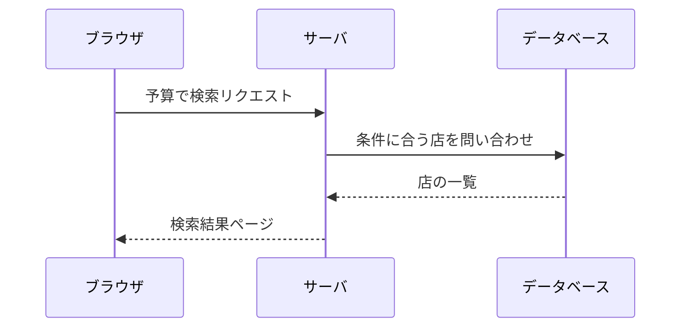
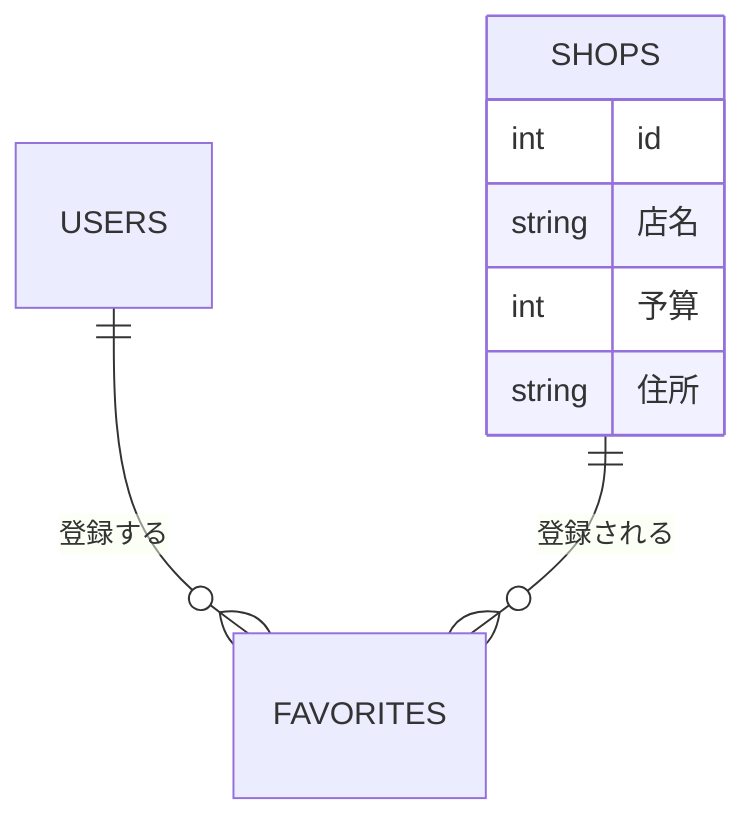
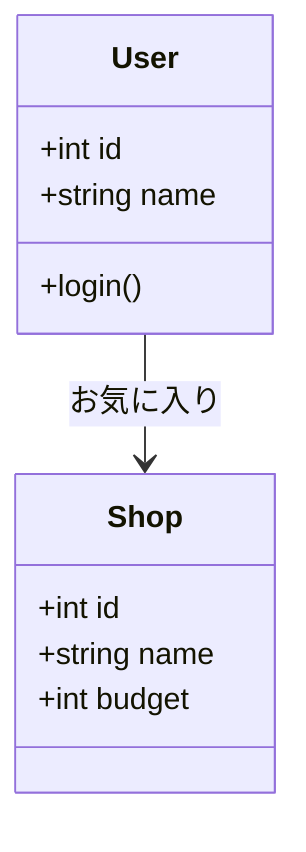
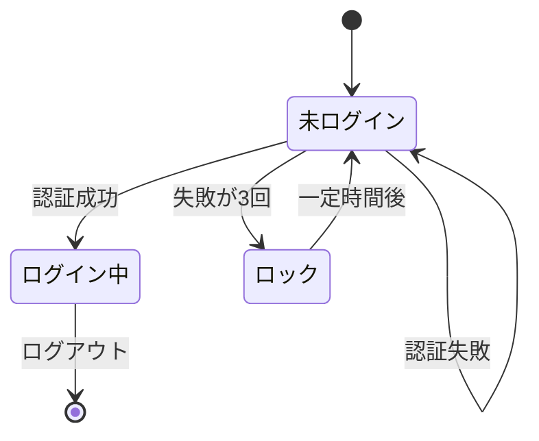

# 付録：Mermaid で図を描く

Mermaid を使うと、シーケンス図・クラス図・ER図などを、テキストで書くだけで図にできます。描画ソフトを使わなくても、リポジトリの中に書いてコードや論文と一緒に管理でき、GitHub 上でそのまま図として表示されます。

## 図の例

たとえば、予算で店を検索する流れは、シーケンス図でこう表せます。



データベースの構造は、ER図でこう表せます。



プログラムの構造は、クラス図で表せます。



状態の移り変わりは、状態遷移図で表せます。ログインの試行と、失敗が続いたときのロックを例にします。



## AIに描かせる

Mermaid はテキストなので、AIに書かせるのが手早いです。コードやファイルを `#` で渡して、どの図にするかを指定します。

```
#search.php この処理の流れを、Mermaid のシーケンス図で書いてください。
```

```
#schema.sql このテーブルどうしの関係を、Mermaid の ER 図で書いてください。
```

```
ログインに3回失敗するとロックされ、一定時間後に解除される仕組みを、Mermaid の状態遷移図で書いてください。
```

返ってきたコードは、[Mermaid Live Editor](https://mermaid.live) に貼ると図で確かめられます。

AIが描いた図は、実際のコードと合っているとは限りません。図の矢印1本ずつを、コードのどこに当たるか確かめます。合っていない図を論文に載せると、説明と作ったものが食い違います。

## Word に貼る

卒業論文に貼る手順は、[卒業論文の執筆](卒業論文の執筆.md) の「Mermaid の図を Word に貼る」にあります。
