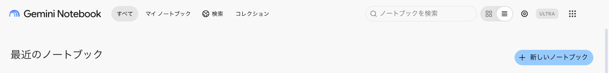
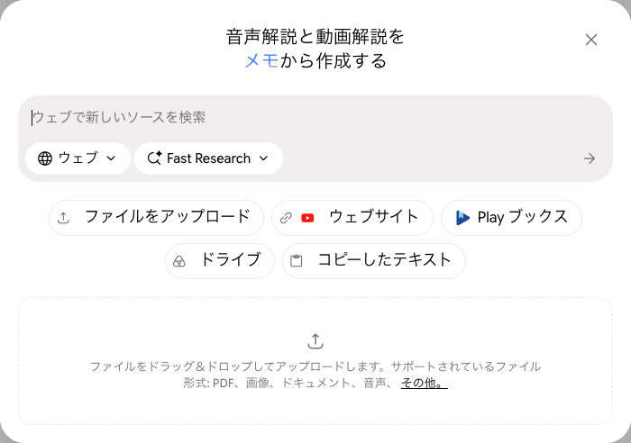
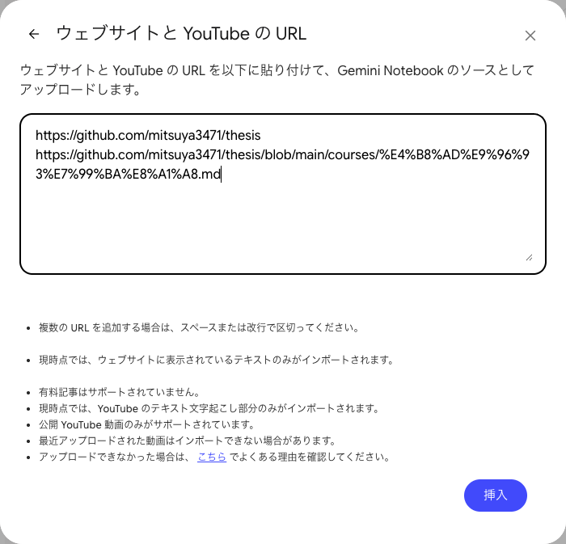
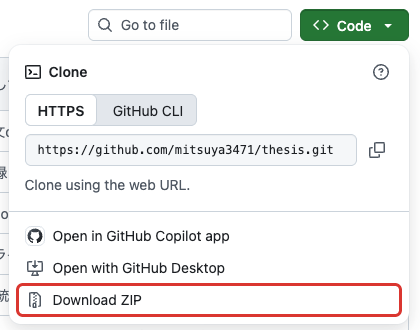
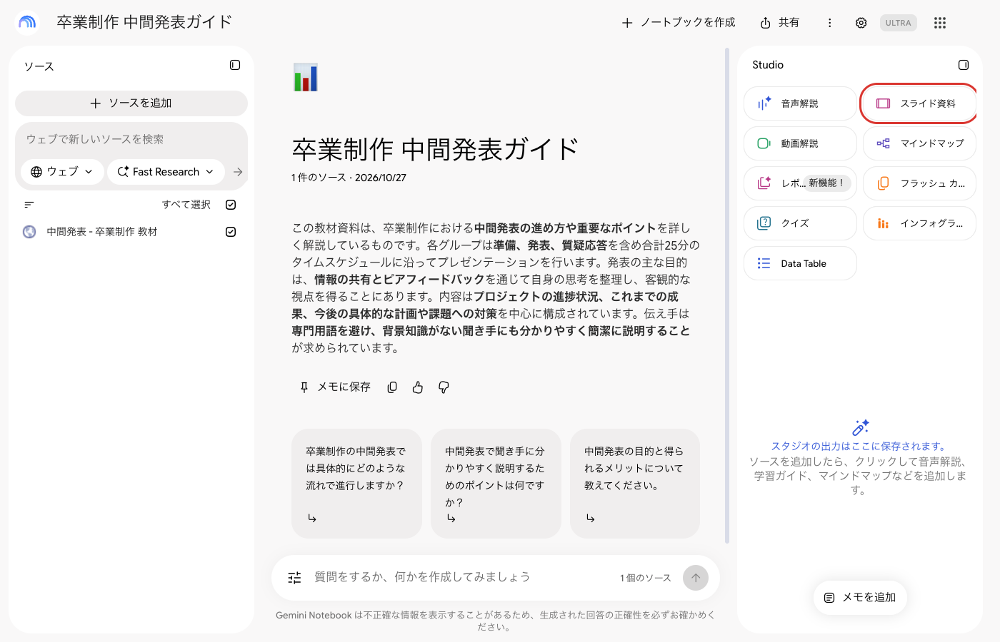
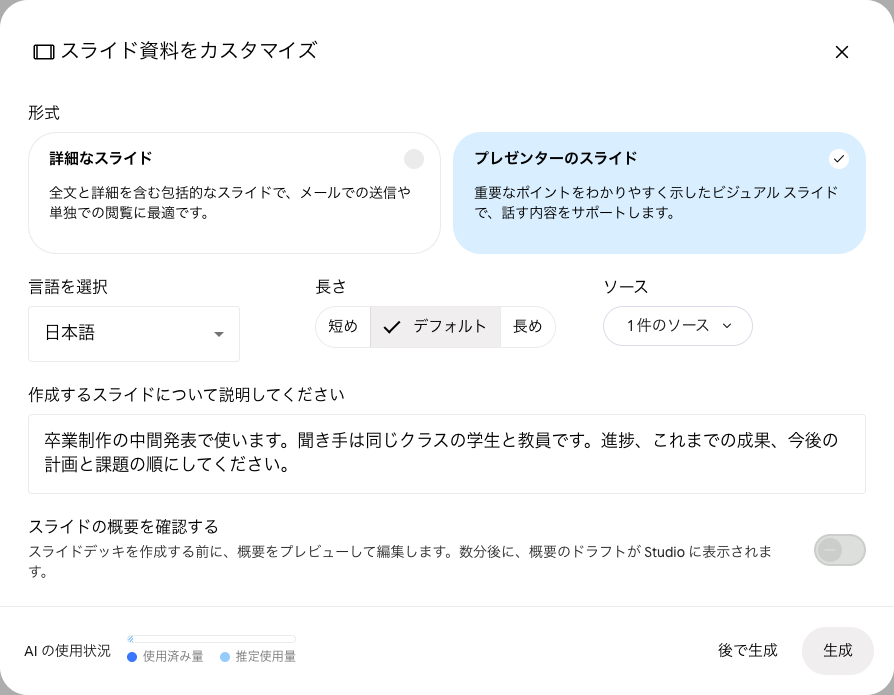
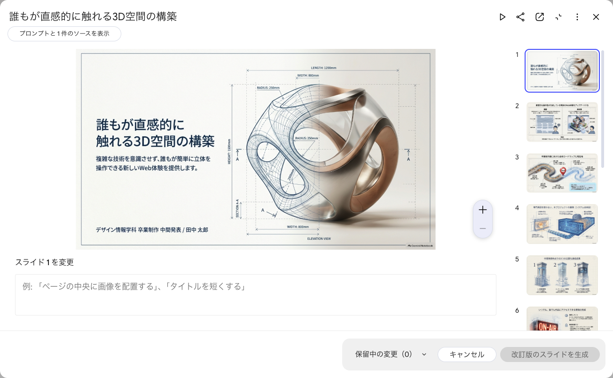
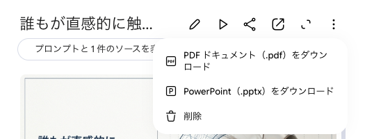

# 付録：NotebookLM でスライドを作る

NotebookLM は、渡した資料をもとに要約やスライドを作る Google のサービスです。現在は Gemini Notebook という名前になっています。

https://notebook.google.com/

## ノートブックを作る

「新しいノートブック」を押します。

## ソースを追加する

スライドの中身は、ここで追加した資料（ソース）から作られます。計画書や週次報告書、作業記録など、発表する内容が書かれた資料を追加します。Googleドライブのファイルは「ドライブ」から選べます。

### GitHub の資料を渡す

公開リポジトリと非公開リポジトリで、渡し方が違います。

#### 公開リポジトリ

「ウェブサイト」に URL を貼ります。リポジトリの URL だけでは、トップページ（README とファイルの一覧）しか読み込まれません。読ませたいファイルを GitHub で開き、そのページの URL を1行ずつ貼ります。

#### 非公開リポジトリ

GitHub の「Code」から「Download ZIP」でダウンロードし、展開します。

「ファイルをアップロード」で、必要なファイルを選びます。まとめて選べます。選べるのは `.md` `.txt` `.pdf` `.docx` `.csv` `.pptx` や画像などで、ZIP のままや、`.py` `.js` `.html` `.ipynb` などのコードのファイルは選べません。

## スライド資料を作る

右の Studio にある「スライド資料」を押します。

形式・長さ・内容の指示を決めて「生成」を押します。発表で使うなら「プレゼンターのスライド」を選びます。数分でできあがります。

## 直す

できたスライドを開き、鉛筆のボタンを押すと、スライドごとに直したい内容を書けます。書き終えたら「改訂版のスライドを生成」を押します。

## ダウンロードする

右上の「︙」から、PDF か PowerPoint でダウンロードできます。

