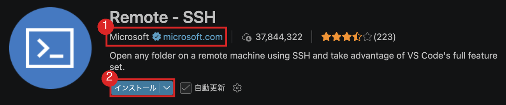

# 付録：SSHの接続

[サーバの構築と公開](サーバの構築と公開.md) のSSHの節で使う、接続の手順です。

## AWSの場合

デフォルトでssh接続が可能になっていますが、公開鍵認証を利用する必要があります。

AWSのコンソールから、`EC2 > インスタンス > [インスタンスID] > 接続 > SSH接続`を選ぶと、接続方法が表示されます。


## OpenSSHの使い方

Windowsの`PowerShell`からssh接続を行うことができます。

```bash
ssh -i <秘密鍵のパス> <ユーザ名>@<IPアドレス>
```

`-i`オプションは秘密鍵へのパスを指定するオプションです。`<ユーザ名>`は接続先のユーザ名、`<IPアドレス>`は接続先のIPアドレスを指定します。

例えば、接続先に`ec2-user`というユーザがいて、IPアドレスが`10.11.12.13`で、秘密鍵が`~/.ssh/mykey.pem`にある場合、以下のように接続します。

```bash
ssh -i ~/.ssh/mykey.pem ec2-user@10.11.12.13
```

また、ssh接続を簡単にするために、`~/.ssh/config`に設定を記述することができます。`~`はユーザのホームディレクトリを表します。

```
Host <ホスト名>
  HostName <IPアドレス>
  User <ユーザ名>
  IdentityFile <秘密鍵のパス>
```

## うまく接続できない場合

`-v`オプションをつけると、デバッグ情報を表示することができます。接続できなかった理由を確認してみましょう。

## Remote - SSH のインストールと使い方

拡張機能をインストールするには、Visual Studio Codeの左側のアイコンから`拡張機能`を選び、検索欄に`Remote - SSH`と入力します。似た名前の拡張機能がいくつか出るので、提供元が Microsoft のものを選んでください。



[Remote - SSH](https://marketplace.visualstudio.com/items?itemName=ms-vscode-remote.remote-ssh)

インストールが完了したら、Visual Studio Codeを再起動してください。

再起動後、`F1`キーを押してコマンドパレットを開き、`Remote-SSH: Open SSH Host...`を選択します。

表示された入力欄に、`<ユーザ名>@<ホスト名>`または`<ユーザ名>@<IPアドレス>`を入力してエンターキーを押します。パスワードを求められた場合は入力してください。（公開鍵認証を利用することをお勧めします）

接続が完了したら、`ファイル > フォルダを開く`を選択して、リモートのフォルダを開きます。

そうすると、ローカルで開発しているかのように、リモートのサーバー上で開発を行うことができます。
