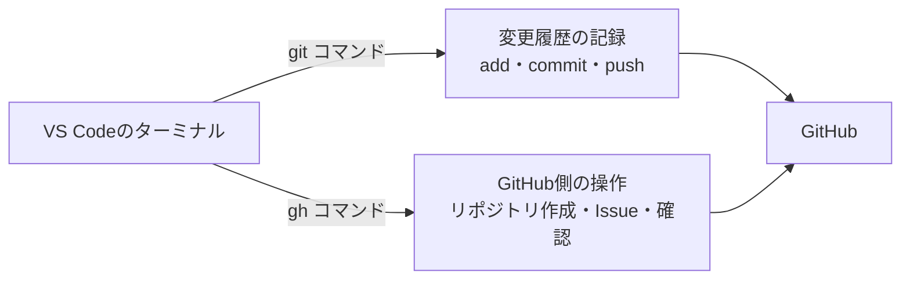

# 付録：GitHub CLI（gh）

`gh` は、GitHubが公式に提供しているコマンドラインツールです。リポジトリの作成やIssueの登録など、これまでブラウザで行っていた操作を、ターミナルから実行できます。



`git` は変更履歴そのものを扱うコマンド、`gh` はGitHub側を操作するコマンドです。

## インストール

PowerShellを開き、次のコマンドを実行します。

```powershell
winget install --id GitHub.cli
```

インストールが終わったらPowerShellを開き直し、`gh --version` でバージョンが表示されれば成功です。

## 認証する

最初の1回だけ、次のコマンドで認証します。

```bash
gh auth login
```

質問に順に答えていきます。

| 質問 | 選ぶもの |
| --- | --- |
| What account do you want to log into? | `GitHub.com` |
| What is your preferred protocol for Git operations? | `SSH` |
| Generate a new SSH key to add to your GitHub account? | `Yes`（鍵がまだない場合） |
| How would you like to authenticate GitHub CLI? | `Login with a web browser` |

最後にブラウザが開き、画面に表示された8桁のコードを入力すると認証が完了します。

この操作で、SSHの鍵ペアの作成と、公開鍵のGitHubへの登録までが自動で行われます。[サーバの構築と公開](サーバの構築と公開.md) の「公開鍵認証のしくみ」がそのまま使われるので、以降は `git push` のたびにパスワードを入力する必要がありません。

いま誰としてログインしているかは、次のコマンドで確認できます。

```bash
gh auth status
```

## よく使うコマンド

| やりたいこと | ブラウザでの操作 | ghコマンド |
| --- | --- | --- |
| リポジトリを作る | New repository から作成 | `gh repo create <名前> --private --source=. --remote=origin --push` |
| リポジトリを複製する | URLをコピーして `git clone` | `gh repo clone <ユーザ名>/<リポジトリ名>` |
| リポジトリのページを開く | ブックマークから開く | `gh repo view --web` |
| Issue（やること）を登録する | Issues タブから New issue | `gh issue create` |

`gh repo create` の例は、手元にある `git init` 済みのプロジェクトをGitHubに非公開リポジトリとして作成し、`origin` として登録したうえで `push` までを一度に行います。[バージョン管理](バージョン管理.md) の「GitHubにリポジトリを作成する」でブラウザから行った作業を、1つのコマンドで済ませられます。誰でも見られる公開リポジトリにする場合は、`--private` を `--public` に変えてください。

## 権限を足す・ログアウトする

足りない権限は、あとから足せます。たとえばプロフィールを書き換えるには `user` が要ります。エージェントが実行することもありますが、ブラウザでの承認は自分でします。

```powershell
gh auth refresh -s user
```

使い終わったらログアウトします。

```powershell
gh auth logout
```
