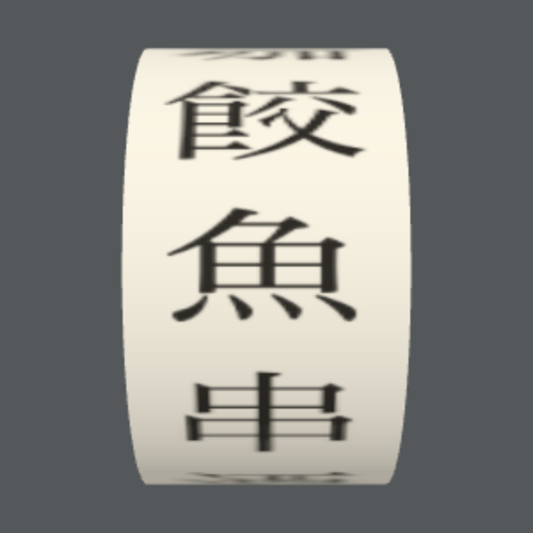

# 付録：three.js で立体を動かす

three.js は、ブラウザで3Dの図形を描いて動かすためのライブラリです。スロットのリールのように、円筒が回って止まる動きを作れます。



## 読み込む

CDN から読み込むので、Node.js のインストールは要りません。HTML の `<head>` に次を書きます。

```html
<script type="importmap">
  { "imports": { "three": "https://cdn.jsdelivr.net/npm/three@0.186.1/build/three.module.js" } }
</script>
```

使う側の `<script>` には `type="module"` を付け、`import * as THREE from "three";` で読み込みます。

## リールを1本回して止める

次の内容を `reel.html` として保存し、ブラウザで開きます。「回す」を押すと3周してから減速し、ランダムに選んだ絵柄で止まります。止まった絵柄は、下の `<p>` に文字で表示されます。

```html
<!DOCTYPE html>
<html lang="ja">
<head>
  <meta charset="utf-8">
  <title>リールの例</title>
  <script type="importmap">
    { "imports": { "three": "https://cdn.jsdelivr.net/npm/three@0.186.1/build/three.module.js" } }
  </script>
</head>
<body>
  <canvas id="reel" width="300" height="300"></canvas>
  <button id="spin">回す</button>
  <p id="result"></p>

  <script type="module">
    import * as THREE from "three";

    // 1. 絵柄の帯を canvas に描き、円筒に貼る画像（テクスチャ）にする
    const symbols = ["丼", "麺", "酒", "串", "魚", "餃", "珈", "甘", "七", "飯"];
    const strip = document.createElement("canvas");
    strip.width = 128 * symbols.length;
    strip.height = 128;
    const ctx = strip.getContext("2d");
    ctx.fillStyle = "#f5efdf";
    ctx.fillRect(0, 0, strip.width, strip.height);
    ctx.fillStyle = "#28251f";
    ctx.font = "96px serif";
    ctx.textAlign = "center";
    ctx.textBaseline = "middle";
    symbols.forEach((s, i) => {
      ctx.save();
      ctx.translate(128 * i + 64, 64);
      ctx.rotate(Math.PI / 2);      // 円筒に貼ると90度倒れるので、先に回しておく
      ctx.fillText(s, 0, 0);
      ctx.restore();
    });

    // 2. シーン・カメラ・レンダラー
    const scene = new THREE.Scene();
    scene.background = new THREE.Color("#55585a");
    const camera = new THREE.PerspectiveCamera(30, 1, 0.1, 100);
    camera.position.z = 7;
    const renderer = new THREE.WebGLRenderer({ canvas: document.querySelector("#reel"), antialias: true });
    scene.add(new THREE.AmbientLight(0xffffff, 1.5));
    const light = new THREE.DirectionalLight(0xffffff, 2);
    light.position.set(2, 3, 5);
    scene.add(light);

    // 3. メッシュ：円筒（形）に絵柄（材質）を貼り、軸を横に倒す
    const geometry = new THREE.CylinderGeometry(1.5, 1.5, 1.6, 64, 1, true);
    geometry.rotateZ(Math.PI / 2);
    const texture = new THREE.CanvasTexture(strip);
    texture.colorSpace = THREE.SRGBColorSpace;
    const material = new THREE.MeshStandardMaterial({ map: texture });
    const reel = new THREE.Mesh(geometry, material);
    scene.add(reel);

    // 4. 止める角度：i 番目の絵柄が正面に来る角度
    const step = (Math.PI * 2) / symbols.length;
    const angleOf = (i) => step * (i + 0.5);
    reel.rotation.x = angleOf(0);

    let from = 0, to = 0, start = 0, duration = 2000, target = 0;
    document.querySelector("#spin").addEventListener("click", () => {
      target = Math.floor(Math.random() * symbols.length);
      from = reel.rotation.x;
      const rest = (angleOf(target) - from) % (Math.PI * 2);
      to = from + Math.PI * 2 * 3 + (rest + Math.PI * 2) % (Math.PI * 2);  // 3周してから止める
      start = performance.now();
    });

    // 5. アニメーションループ：毎フレーム角度を更新して描き直す
    renderer.setAnimationLoop((now) => {
      if (start) {
        const t = Math.min((now - start) / duration, 1);
        reel.rotation.x = from + (to - from) * (1 - (1 - t) ** 3);  // だんだん遅くなる
        if (t === 1) {
          start = 0;
          document.querySelector("#result").textContent = symbols[target];
        }
      }
      renderer.render(scene, camera);
    });
  </script>
</body>
</html>
```

## 5つの考え方

three.js のコードは、次の5つでできています。

| 考え方 | コード | 役割 |
| --- | --- | --- |
| シーン | `new THREE.Scene()` | 物を置く空間 |
| カメラ | `new THREE.PerspectiveCamera(...)` | どこから見るか |
| レンダラー | `new THREE.WebGLRenderer(...)` | カメラから見た様子を `<canvas>` に描く |
| メッシュ | `new THREE.Mesh(geometry, material)` | 形（ジオメトリ）と材質（マテリアル）を組み合わせた物 |
| アニメーションループ | `renderer.setAnimationLoop(...)` | 毎フレーム呼ばれる。角度を変えて描き直す |

この例では、形は円筒（`CylinderGeometry`）で、材質には絵柄を描いた画像を貼っています。円筒は縦向きにできるので、`rotateZ` で横に倒しています。

## 止める位置を決める

`reel.rotation.x` が円筒の回転の角度です。絵柄は10個なので、1つあたり `2π ÷ 10` です。`angleOf(i)` は、`i` 番目の絵柄が正面に来る角度を返します。

「回す」を押すと、今の角度から3周したうえで `angleOf(target)` に着く角度を `to` にします。アニメーションループでは、経過時間の割合 `t` を `1 - (1 - t) ** 3` に変えてから角度を決めています。始めは速く、終わりに近づくほど遅くなります。

## エージェントに頼む

このページを `#fetch` で読ませて頼みます。

```
#fetch https://mitsuya3471.github.io/thesis/courses/付録_threejs/
この例をもとに、リールを3本にして、左・中央・右の順に止めてください。
店名は今の HTML のまま表示してください。
```
