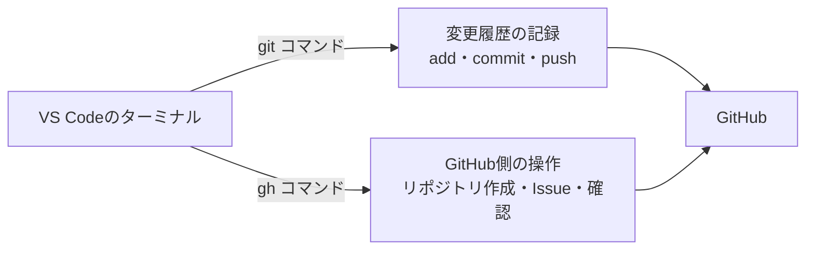
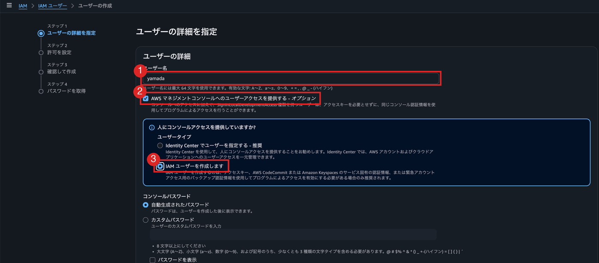
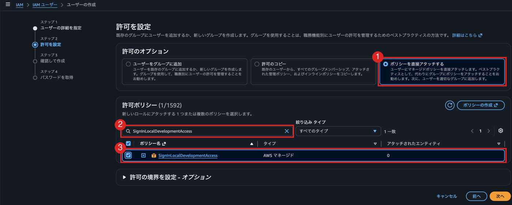
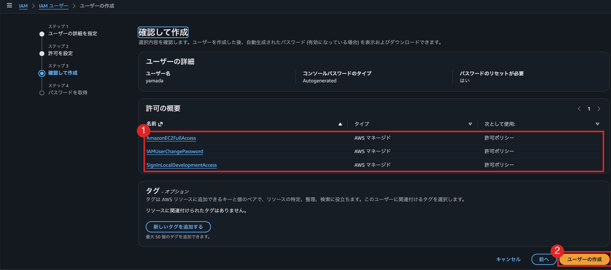

# 付録：ターミナルで操作する

エージェントにGitHubやGoogleドライブ、AWSを操作させるための準備です。どれもPowerShellで、インストールとログインを一度済ませておきます。ログインの仕組みは [付録：ブラウザでのログインとトークン](付録_ブラウザでのログインとトークン.md) にあります。

| 操作したいもの | コマンド | ログイン | ログアウト |
| --- | --- | --- | --- |
| GitHub | `gh` | `gh auth login` | `gh auth logout` |
| Googleドライブ | `rclone` | `rclone config` | `rclone config disconnect gdrive:` |
| AWS | `aws` | `aws login` | `aws logout` |

## GitHub（gh）

`gh` は、GitHubが公式に提供しているコマンドラインツールです。リポジトリの作成やIssueの登録など、これまでブラウザで行っていた操作を、ターミナルから実行できます。



`git` は変更履歴そのものを扱うコマンド、`gh` はGitHub側を操作するコマンドです。

### インストール

PowerShellを開き、次のコマンドを実行します。

```powershell
winget install --id GitHub.cli
```

インストールが終わったらPowerShellを開き直し、`gh --version` でバージョンが表示されれば成功です。

### 認証する

最初の1回だけ、次のコマンドで認証します。

```bash
gh auth login
```

質問に順に答えていきます。

| 質問 | 選ぶもの |
| --- | --- |
| What account do you want to log into? | `GitHub.com` |
| What is your preferred protocol for Git operations? | `SSH` |
| Generate a new SSH key to add to your GitHub account? | `Yes`（鍵がまだない場合） |
| How would you like to authenticate GitHub CLI? | `Login with a web browser` |

最後にブラウザが開き、画面に表示された8桁のコードを入力すると認証が完了します。

この操作で、SSHの鍵ペアの作成と、公開鍵のGitHubへの登録までが自動で行われます。[サーバの構築と公開](サーバの構築と公開.md) の「公開鍵認証のしくみ」がそのまま使われるので、以降は `git push` のたびにパスワードを入力する必要がありません。

いま誰としてログインしているかは、次のコマンドで確認できます。

```bash
gh auth status
```

### よく使うコマンド

| やりたいこと | ブラウザでの操作 | ghコマンド |
| --- | --- | --- |
| リポジトリを作る | New repository から作成 | `gh repo create <名前> --private --source=. --remote=origin --push` |
| リポジトリを複製する | URLをコピーして `git clone` | `gh repo clone <ユーザ名>/<リポジトリ名>` |
| リポジトリのページを開く | ブックマークから開く | `gh repo view --web` |
| Issue（やること）を登録する | Issues タブから New issue | `gh issue create` |

`gh repo create` の例は、手元にある `git init` 済みのプロジェクトをGitHubに非公開リポジトリとして作成し、`origin` として登録したうえで `push` までを一度に行います。[バージョン管理](バージョン管理.md) の「GitHubにリポジトリを作成する」でブラウザから行った作業を、1つのコマンドで済ませられます。誰でも見られる公開リポジトリにする場合は、`--private` を `--public` に変えてください。

### 権限を足す・ログアウトする

足りない権限は、あとから足せます。たとえばプロフィールを書き換えるには `user` が要ります。エージェントが実行することもありますが、ブラウザでの承認は自分でします。

```powershell
gh auth refresh -s user
```

使い終わったらログアウトします。

```powershell
gh auth logout
```

## Googleドライブ（rclone）

```powershell
winget install Rclone.Rclone
rclone config
```

`rclone config` を実行すると、次のように聞かれます。入力する箇所だけ示します。

```{ .console .terminal }
e) Edit existing remote
n) New remote
d) Delete remote
q) Quit config
e/n/d/q> n                      ← 新しい接続を作る

Enter name for new remote.
name> gdrive                    ← 好きな名前

Option Storage.
Type of storage to configure.
 1 / 1Fichier
   \ (fichier)
   （…50件以上並ぶので、Google Drive の番号を探す…）
24 / Google Drive
   \ (drive)
Storage> drive                  ← 番号でも名前でも可

Option client_id.
Google Application Client Id
Enter a value. Press Enter to leave empty.
client_id>                      ← 何も入れずEnter

Option client_secret.
client_secret>                  ← 何も入れずEnter

Option scope.
 1 / Full access all files, excluding Application Data Folder.
   \ (drive)
 2 / Read-only access to file metadata and file contents.
   \ (drive.readonly)
scope> 1                        ← 読み書きしたいので1

Option service_account_file.
service_account_file>           ← 何も入れずEnter

Edit advanced config?
y/n> n

Use web browser to automatically authenticate rclone with remote?
y/n> y                          ← ブラウザが開く
```

最後にブラウザが開くので、自分のGoogleアカウントで許可します。以降は認証なしで使えます。

使い方の例です。

```powershell
rclone ls gdrive:                              # ファイルの一覧
rclone copy 計画書.docx gdrive:                 # アップロード
rclone copy gdrive:週次報告書（回答）.xlsx .      # ダウンロード
rclone cat gdrive:メモ.txt                      # 中身を表示
```

`.txt` や `.docx` をアップロードするとき、次を付けるとGoogleドキュメントに変換されます。

```powershell
rclone copy 計画書.txt gdrive: --drive-import-formats txt --drive-export-formats txt
```

使い終わったら接続を解除します。学校のPCは共用で、許可した情報は `%APPDATA%\rclone\rclone.conf` に残ります。そのままにすると、次に使う人が自分のGoogleドライブを操作できてしまいます。

```powershell
rclone config disconnect gdrive:    # Google側の許可を取り消す
rclone config delete gdrive         # 設定そのものを消す
```

自分のPCなら、残しておいて構いません。

## AWS（aws）

インストールは次の1行です。管理者の権限は要りません。

```powershell
irm https://awscli.amazonaws.com/v2/install.ps1 | iex
```

PowerShellを開き直し、`aws --version` でバージョンが表示されれば成功です。

`irm` はURLの中身をダウンロードするコマンド、`iex` は受け取った文字列をそのまま実行するコマンドです。AWSが配布しているインストール用のスクリプトを、ダウンロードして実行しています。

### IAMユーザーを作る

`aws login` には、ルートユーザー（AWSに登録したときのメールアドレス）ではなく、IAMユーザーでログインします。ルートユーザーは何でもできてしまうので、普段の作業には使いません。

AWSのコンソールで、ルートユーザーとしてログインして作ります。検索欄に `IAM` と入れて開き、左のメニューの「ユーザー」から「ユーザーの作成」を押します。

ユーザーの詳細を指定します。

1. ユーザー名を入れる
2. 「AWS マネジメントコンソールへのユーザーアクセスを提供する」にチェックを入れる
3. 「IAM ユーザーを作成します」を選ぶ。パスワードは自動生成のままでよい



次へ進み、許可を設定します。

1. 「ポリシーを直接アタッチする」を選ぶ
2. 検索欄にポリシー名を入れる
3. 出てきたポリシーにチェックを入れる



チェックを入れるポリシーは2つです。1つ選んだら、検索し直してもう1つ選びます。

- `SignInLocalDevelopmentAccess`（`aws login` に必要）
- 使うサービスのポリシー。EC2なら `AmazonEC2FullAccess`

確認画面で、選んだポリシーが並んでいることを確かめて「ユーザーの作成」を押します。`IAMUserChangePassword` は、初回ログインでパスワードを変えるために自動で付きます。



最後の画面に、コンソールのサインインURLとパスワードが表示されるので控えます。

以降は、控えたURLを開いてIAMユーザーでログインします。

### ログインする

`aws login` を実行するとブラウザが開き、AWSのコンソールと同じ画面でログインします。初めてのときはリージョンを聞かれるので、東京なら `ap-northeast-1` と入れます。

```{ .console .terminal }
> aws login
AWS Region [us-east-1]: ap-northeast-1          ← 初回だけ聞かれる
Attempting to open the login page for `ap-northeast-1` in your default browser.
                                                 ← ブラウザでログインして、ターミナルに戻る
> aws sts get-caller-identity                    ← ログインできたか確かめる
{
    "Account": "123456789012",
    "Arn": "arn:aws:iam::123456789012:user/yamada"
}
> aws ec2 describe-instances                     ← 以降は普通に使える
> aws logout                                     ← 使い終わったら消す
```

- AWS CLI のバージョン 2.32.0 以降が必要です
- IAMユーザでログインする場合は、そのユーザに `SignInLocalDevelopmentAccess` というポリシーを付けておきます
