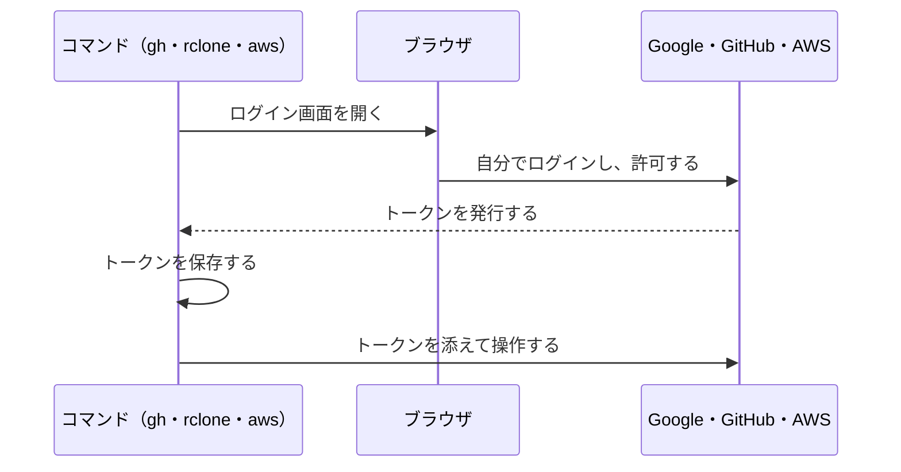
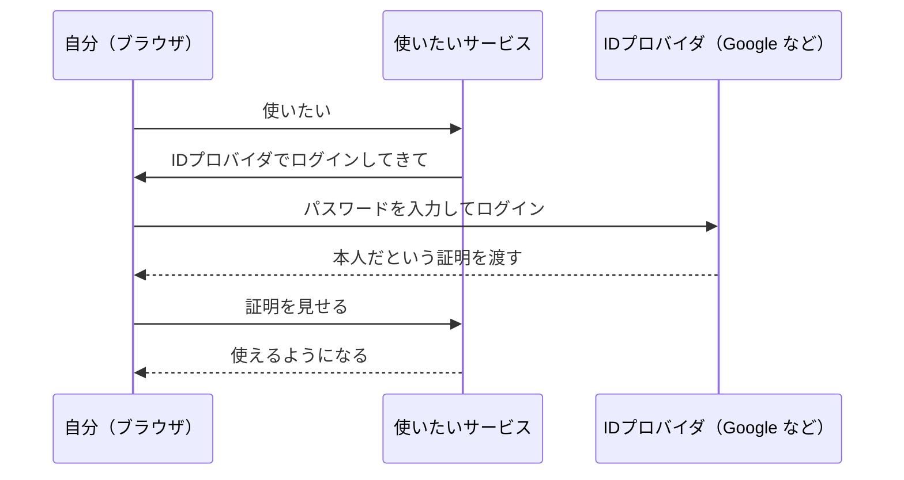
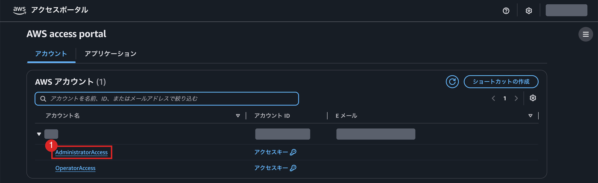

# 付録：ブラウザでのログインとトークン

`gh` や `rclone`、`aws` のようなコマンドは、パスワードを受け取りません。ブラウザでログインして許可すると、コマンドはトークンを受け取り、以降はそれを使ってサービスを操作します。

## トークン

ログインに成功すると、サービスはトークンという長い文字列を発行します。コマンドは、リクエストのたびにこれを添えて送ります。期限付きなので、一時的な認証情報とも呼ばれます。

トークンには、次の性質があります。

| 性質 | 内容 |
| --- | --- |
| 権限の範囲 | 許可したことしかできない。`gh` の `user` や、rclone の読み取り専用などの範囲（スコープ）で決まる |
| 有効期限 | 期限が切れると、自動で更新されるか、ログインし直す |
| 取り消し | ログアウトや設定画面から無効にできる。パスワードを変える必要はない |

## ブラウザで許可する2つの方式

| 方式 | 流れ | 例 |
| --- | --- | --- |
| ブラウザが開く | コマンドがブラウザを開き、許可するとそのまま戻る | `rclone config`、`aws login` |
| コードを入力する | コマンドが短いコードを表示し、ブラウザでそのコードを入力して許可する | `gh auth login` |

どちらも、許可する画面で何の権限を渡すのかが表示されます。エージェントがログインを求めてきたときも、この画面は自分で確かめます。

## SSO（シングルサインオン）

1つのアカウントでログインすれば、複数のサービスを使える仕組みです。学校のGoogleアカウントで、Classroom もドライブもフォームも使えるのがこれにあたります。

SSOでは、ログインを受け持つ側と、使われる側が分かれています。ログインを受け持つ側をIDプロバイダ（IdP）と呼びます。

パスワードを入力するのは、IDプロバイダの画面だけです。ここで渡される「本人だという証明」も、トークンの一種です。使われる側のサービスは、パスワードを受け取りません。受け取るのは「この人は本人だ」という証明だけです。

| | サービスごとにパスワード | SSO |
| --- | --- | --- |
| パスワードを渡す相手 | 使うサービスすべて | IDプロバイダだけ |
| 1つのサービスから漏れたとき | 同じパスワードを使い回していれば、ほかも危ない | パスワードは漏れない |
| 使えなくするとき | サービスごとに止める | IDプロバイダで止めれば全部止まる |

ブラウザでログインしてトークンを受け取ることと、SSOは別のことです。`gh auth login` や `aws login` は、ブラウザでログインしますが、入れるのはそのサービス1つだけなのでSSOではありません。SSOは、1回のログインで複数のサービスに入れることを指します。

## AWSを共有PCで使う

AWS CLI には、ログインの方法が2つあります。共有PCでは、ブラウザでログインする方を使います。`aws login` はSSOではありませんが、PCに残るのが一時的な認証情報なので、共有PCでも安全に使えます。

| | アクセスキー（`aws configure`） | ブラウザでログイン（`aws login`） |
| --- | --- | --- |
| PCに残るもの | 期限のないアクセスキー | 一時的な認証情報 |
| 有効期限 | なし。自分で無効にするまで使える | 最長12時間 |
| 消し忘れたとき | 次に使う人が、いつまでも自分のAWSを操作できる | 期限が来れば使えなくなる |

コマンドの使い方は [付録：ターミナルで操作する](付録_ターミナルで操作する.md) にあります。

AWSのSSOは、IAM Identity Center という別の仕組みです。組織でAWSアカウントを管理している場合に使います。

1回ログインすると、アクセスポータルに自分が入れるAWSアカウントと権限の一覧が出ます。権限の名前を押すと、そのままコンソールに入れます。

コマンドから使うときは `aws configure sso`、`aws sso login`、`aws sso logout` です。こちらも、PCに残るのは一時的な認証情報です。

## 扱いの注意

トークンは、パスワードと同じです。持っている人は誰でも、許可した範囲の操作ができます。

- GitHub にアップロードしない。チャットにも貼らない
- 共用のPCでは、使い終わったらログアウトしてトークンを消す

| コマンド | トークンの置き場所 | 消し方 |
| --- | --- | --- |
| `gh` | Windows の資格情報マネージャー | `gh auth logout` |
| `rclone` | `%APPDATA%\rclone\rclone.conf` | `rclone config disconnect gdrive:` |
| `aws`（`aws login`） | `%USERPROFILE%\.aws\login\cache` | `aws logout` |
