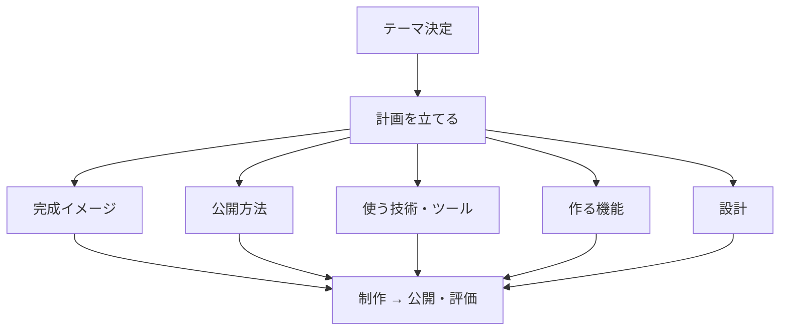
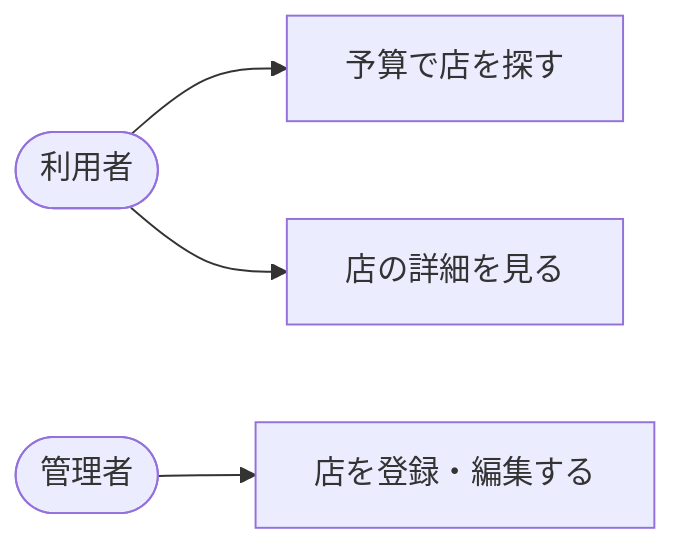

# 計画立案と要件定義

テーマが決まったら、いきなり作り始めるのではなく、まず「何を・どう作り・どう公開するか」を計画にまとめます。ここでまとめた内容が、提出する卒業制作計画書になります。

## なぜ計画を立てるのか

計画を立てずに作り始めると、次のような行き詰まりが起きがちです。

- 動くものはできたが「これ、どうやって他の人に見せる（公開する）の？」となる
- 途中で使う技術や公開先を変えることになり、作ったものを大きく作り直す
- 必要な機材やサーバを用意していなくて、制作が止まる

完成した姿と公開方法を先に決め、必要な技術・環境を洗い出しておきます。

## 完成イメージと公開方法を先に決める

制作物は、誰かに使ってもらえる状態にして初めて完成です。作り始める前に、次の3つを決めます。

### 完成イメージ

- 誰が使うのか（一般の人／校内の人／自分たち）
- どの端末で使うのか（PCのブラウザ／スマートフォン／専用の機器）
- どこで使うのか（インターネット上／校内ネットワークだけ／手元のPC）
- どう使うのかの流れ（画面を開く → ログインする → 〇〇する …）

### 公開方法

作ったものをどうやって外に見せるかを決めます。これによって必要な環境が変わります。

- 手元で一時的にデモする: 発表や動作確認のときだけ公開する。Cloudflare Tunnel を使う
- 常時公開する: いつでもアクセスできるようにする。GitHub Pages、またはAWS EC2を使う

公開の手順は、[サーバの構築と公開](サーバの構築と公開.md) の「インターネットへの公開」にあります。

### 使用する技術・ツール

制作に使う技術を決めます。

- プログラミング言語（例: Python、JavaScript、Go）
- フレームワーク・ライブラリ（例: Flask、Node.js、Gradio）
- データベース（例: MySQL、PostgreSQL）
- サーバ・実行環境（例: Apache、Docker、VPS）

ツール名まで書き出します。名前が挙げられない部分は、まだ調べ足りない部分です。

## 開発の進め方（使うツール）を決める

コードをどこで書き、どこで動かし、どう保存・共有するかを決めます。こだわりがなければ、次の進め方で構いません。使い方は、このあとの授業で学びます。

- コードを書く: Visual Studio Code（VSCode）
- サーバ上で開発する: Remote-SSH（VSCodeの拡張機能）。手元のVSCodeから、サーバ上のファイルを直接編集・実行できます
- コードを保存・共有する: git + GitHub
- 動作を確認する: どのコマンドで起動し、どのURL（またはIPアドレス）をブラウザで開くか

計画には、次のように書きます。

> 例: VSCode + Remote-SSH で さくらのVPS 上のファイルを直接編集して開発し、コードは GitHub で管理する。`node server.js` で起動し、ブラウザでアクセスして動作を確認する。

## 作る機能を書き出す（要件定義）

必要な機能（機能要件）と、求められる品質（非機能要件）を書き出します。

### どんな機能が必要か（機能要件）

作りたい機能の一覧を書き出します。例えば、オンラインゲームなら次のようになります。

- ログイン機能
- アカウント情報の編集
- ランキング表示
- チャット機能

あわせて、誰が何をするのか（ユースケース）を図にします。例えばグルメサイトなら、次のようになります。

### 品質の目標（非機能要件）

機能そのものではなく、どのくらい速く、誰が、いつまで使えればよいかといった目標です。次の観点ごとに、自分の制作物ではどうするかを決めます。

| 観点 | 決めること | 例（グルメサイト） |
| --- | --- | --- |
| 速さ | 操作してから結果が出るまで何秒か | 検索結果は2秒以内に表示する |
| 同時に使う人数 | 何人が同時に開いても動けばよいか | 発表で30人が同時に開いても動く |
| 使える期間 | いつまで、どの時間に使えればよいか | 研究発表の日まで、いつでも開ける |
| 端末 | どの端末・ブラウザで使えればよいか | スマホとPCのChromeで崩れずに表示される |
| セキュリティ | 誰に何をさせないか | 店の登録・編集は、ログインした管理者だけができる |
| データ | 消えたときにどこまで戻せればよいか | 店のデータを週に1回バックアップする |
| 費用 | 月にいくらまでかけられるか | サーバ代は月1000円以内 |

「速く」「安全に」だけでは、できたかどうか確かめられません。数字や、誰が何をできるかの形で書きます。

## 設計

要件定義で洗い出した内容を、実際に作れる形に落とし込みます。設計は、作りながら変えて構いません。

### 基本設計

使用するコンポーネント（Webサーバー、データベース、DNSサーバーなど）と、その関係・役割を決め、構成図にします。

### 詳細設計

基本設計を、より細かく決めます。

- データベースのテーブル定義（どんな表に、どんな列を持たせるか）
- WebサーバーのAPI定義（どのURLで、どんな処理を返すか）
- Webサーバー（Apache）の設定: 公開ポート（80 / 443）、HTTPSにするか、HTMLやプログラムを置く場所（DocumentRoot）、編集する設定ファイル（`000-default.conf` など）
- DNSの設定

設定の手順は [付録：Apacheの設定](付録_Apacheの設定.md) にあります。

### 設計を図で表す（UML）

設計は、図で表すと分かりやすくなります。作った図は、そのまま論文に載せられます。

プログラムの設計では、[統一モデリング言語](https://ja.wikipedia.org/wiki/%E7%B5%B1%E4%B8%80%E3%83%A2%E3%83%87%E3%83%AA%E3%83%B3%E3%82%B0%E8%A8%80%E8%AA%9E)（UML）がよく利用されます。UMLは、システムの静的な構造を表す「構造図」と、動的な振る舞いを表す「振る舞い図」に分けられます。

#### 構造図

- クラス図
- コンポーネント図
- デプロイメント図
- コンポジット構造図
- オブジェクト図
- パッケージ図

#### 振る舞い図

- ユースケース図
- シーケンス図
- アクティビティ図
- ステートマシン図

これらの図は、Mermaid を使うとテキストで書くだけで描けます。AIに書かせることもできます。書き方と例は [付録：Mermaid で図を描く](付録_Mermaid.md) にあります。

## 計画の記入例

「予算で探せる 近隣グルメサイト」を計画した例です。

① 完成イメージ
学校の近くで、予算内で入れる飲食店を探せるWebサイト。利用者は自分のスマホやPCのブラウザから開き、予算を入れると条件に合う店の一覧が見られる。インターネットに公開する。

② 公開方法
さくらのVPS上にApacheを立てて常時公開する。発表前の動作確認は Cloudflare Tunnel でも行う。

③ 使う技術
言語 = PHP／データベース = MySQL／Webサーバー = Apache／OS = Ubuntu（VPS）

④ 開発の進め方
VSCode + Remote-SSH で VPS 上のファイルを直接編集して開発する。コードは GitHub で管理する。`http://<VPSのIPアドレス>/` をブラウザで開いて動作を確認する。

⑤ 作る機能
- 店の一覧表示
- 予算による絞り込み
- 店の詳細表示
- （管理者）店の登録・編集

⑥ 品質の目標
- 検索結果は2秒以内に表示する
- スマホとPCのChromeで崩れずに表示される
- 店の登録・編集は、ログインした管理者だけができる
- サーバ代は月1000円以内

⑦ 設計
- 基本設計: ブラウザ → Apache（表示）→ PHP（処理）→ MySQL（店データ）の流れ
- 詳細設計（Apache）: 公開ポート = 80／HTTPS = まずはしない（後で対応）／DocumentRoot = `/var/www/html`（ここにPHPファイルを置く）／編集する設定ファイル = `/etc/apache2/sites-available/000-default.conf`
- 詳細設計（DB）: `shops` テーブル（id、店名、予算、住所、電話番号）

## 計画書にまとめる

ここまでで決めた内容を、卒業制作計画書にまとめて提出します。計画書は Google Classroom で配布される Google ドキュメントです。

使用する端末やソフトウェア、ネットワーク構成（IPアドレスやルーターの設定など）も書きます。
